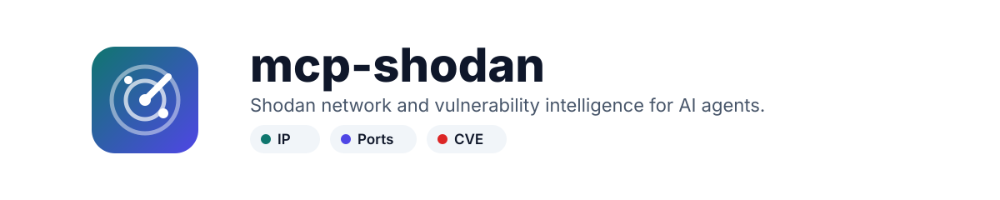
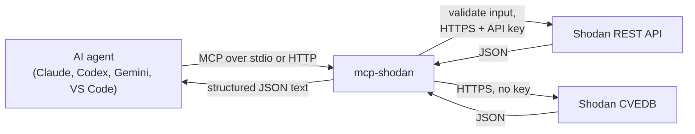

<p align="center">
  <picture>
    <source media="(prefers-color-scheme: dark)" srcset="docs/assets/banner-dark.svg">
    
  </picture>
</p>

<p align="center">
  <a href="https://www.npmjs.com/package/@burtthecoder/mcp-shodan"></a>
  <a href="https://github.com/w0h1v/mcp-shodan/actions/workflows/ci.yml"></a>
  <a href="LICENSE"></a>
  
  <a href="https://registry.modelcontextprotocol.io"></a>
  <a href="https://smithery.ai/server/@burtthecoder/mcp-shodan"></a>
</p>

<p align="center">
  <a href="#quickstart">Quickstart</a> ·
  <a href="#tools">Tools</a> ·
  <a href="#http-streaming-transport">HTTP</a> ·
  <a href="#security">Security</a> ·
  <a href="#troubleshooting">Troubleshooting</a> ·
  <a href="https://w0h1v.github.io/mcp-shodan/">Docs</a>
</p>

**mcp-shodan** is an [MCP](https://modelcontextprotocol.io) server that gives AI agents access to the [Shodan API](https://developer.shodan.io/api) and [Shodan CVEDB](https://cvedb.shodan.io). Hand your agent an IP, hostname, search query, product or CVE and get back what an analyst would look at: open ports and banners, TLS certificates, DNS, and vulnerability severity with EPSS and KEV status.

> [!NOTE]
> Independent project, not affiliated with Shodan. You need your own [Shodan API key](https://account.shodan.io/).

## Highlights

- **Host reconnaissance.** Open ports, service banners, HTTP titles, TLS certificate details (fingerprint, JARM, JA3S), cloud provider and tags for any IPv4 or IPv6 address.
- **Device search.** Shodan query syntax with a country breakdown of all matches.
- **Vulnerability intelligence.** CVE details with CVSS, EPSS and KEV; CVEs by product or CPE, sortable by EPSS. CVEDB is free and doesn't spend query credits.
- **Batch DNS.** Forward and reverse lookups for many names or IPs in one call.
- **Two transports.** stdio for desktop clients, HTTP streaming for a shared service.
- **Tested.** Unit tests with a mocked Shodan API run in CI on Node 20, 22 and 24.

## How it works



## Quickstart

**Requirements:** Node.js 20 or newer and a Shodan API key.

```sh
# Claude Code
claude mcp add --transport stdio --env SHODAN_API_KEY=your-key shodan -- npx -y @burtthecoder/mcp-shodan

# Codex CLI
codex mcp add shodan --env SHODAN_API_KEY=your-key -- npx -y @burtthecoder/mcp-shodan

# Gemini CLI
gemini mcp add -e SHODAN_API_KEY=your-key shodan npx -y @burtthecoder/mcp-shodan
```

For Claude Desktop, VS Code, Smithery and running from source, see [Connect a client](docs/clients.md).

Then ask your agent: *"What is exposed on 8.8.8.8, and is CVE-2021-44228 in the KEV catalog?"* More prompts are in [example workflows](docs/examples.md).

## Tools

Seven read-only tools. Full parameters are in the [tool reference](docs/tools.md).

| Group | Tool | What it does |
|---|---|---|
| Network | `ip_lookup` | Ports, banners, TLS, location, cloud and hostnames for one IP |
| | `shodan_search` | Search devices with Shodan query syntax (1-100 results, country breakdown) |
| | `dns_lookup` | Resolve hostnames to IPs, in batch |
| | `reverse_dns_lookup` | Hostnames for IPs, in batch |
| Vulnerabilities (CVEDB) | `cve_lookup` | CVSS, EPSS, KEV, references and affected CPEs for one CVE |
| | `cpe_lookup` | CPE 2.3 identifiers for a product name |
| | `cves_by_product` | CVEs for a product or CPE, filterable by KEV and date, sortable by EPSS |

> [!TIP]
> Filtered `shodan_search` queries need a Shodan membership and cost one query credit each. `ip_lookup`, the DNS tools and the CVEDB tools work on a free account.

## HTTP streaming transport

stdio is the default. Set `MCP_TRANSPORT=httpStream` to run a standalone HTTP service:

```sh
MCP_TRANSPORT=httpStream MCP_PORT=3000 SHODAN_API_KEY=your-key node build/index.js
```

```sh
docker build -t mcp-shodan .
docker run -p 127.0.0.1:3000:3000 -e SHODAN_API_KEY=your-key -e MCP_TRANSPORT=httpStream mcp-shodan
```

A health check is served at `/health`.

### Environment variables

| Variable | Default | Description |
|---|---|---|
| `SHODAN_API_KEY` | *(required)* | Your Shodan API key |
| `MCP_TRANSPORT` | `stdio` | `stdio` or `httpStream` |
| `MCP_HOST` | `localhost` | Bind address (`httpStream` only). The Docker image sets `0.0.0.0` |
| `MCP_PORT` | `3000` | HTTP port (`httpStream` only) |
| `MCP_ENDPOINT` | `/mcp` | HTTP endpoint path (`httpStream` only) |

## Security

> [!WARNING]
> The HTTP transport has **no authentication**. Keep the port on localhost or behind an authenticating reverse proxy, or anyone who can reach it can spend your query credits.

- Tool arguments are validated with zod schemas before any request is built. IPs must be valid IPv4 or IPv6 and CVE IDs must match `CVE-YYYY-NNNN`.
- The API key is read from the environment and sent only to `api.shodan.io`. CVEDB calls carry no key.
- What you look up is sent to Shodan.

Report vulnerabilities privately; see [SECURITY.md](SECURITY.md).

## Troubleshooting

- **401 / invalid key:** check for spaces or quotes around the key, then restart the client. `curl "https://api.shodan.io/api-info?key=$SHODAN_API_KEY"` shows your plan and credits.
- **403 on `shodan_search`:** search filters need a membership or paid API plan.
- **429:** Shodan allows about one request per second. Retry after a moment.

More in the [troubleshooting guide](docs/troubleshooting.md).

## Development

```sh
git clone https://github.com/w0h1v/mcp-shodan && cd mcp-shodan
npm ci
npm test                          # build + unit tests, no key or network
npx fastmcp dev build/index.js    # try tools interactively (needs SHODAN_API_KEY)
```

See [CONTRIBUTING.md](CONTRIBUTING.md) and the [changelog](CHANGELOG.md).

## License

MIT. See [LICENSE](LICENSE).
